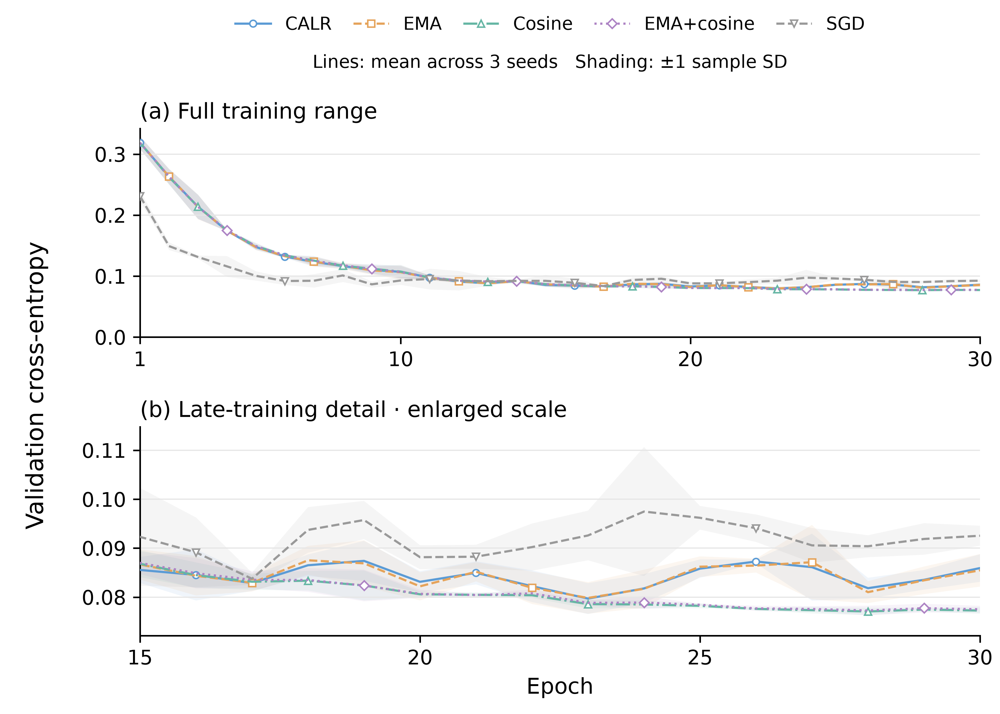
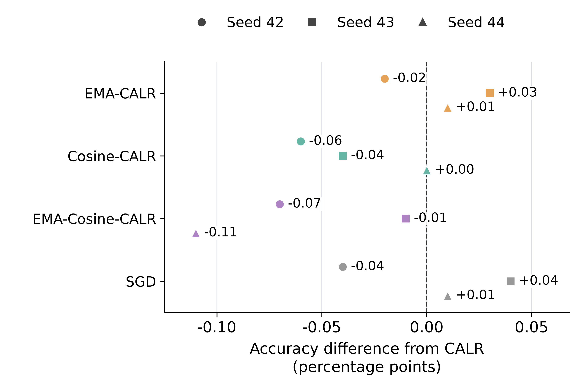

# CALR Reproduction and Improvement Study

This repository contains two stages: a source-informed reproduction of four released CALR experiments, followed by a controlled MNIST study of gradient-magnitude smoothing and cosine learning-rate decay. The original method and reference code are credited to Gayan Maduranga; the original MIT license is retained.

## Improvement project

The [controlled CALR improvement study](improvement_project/README.md) extends the reproduction with gradient-magnitude smoothing and cosine learning-rate decay. It includes five methods across three matched seeds, saved checkpoints, plots, and verification tools.

The combined variant reduced mean test loss by 3.63%, but accuracy decreased from 97.84% to 97.78%. The original reproduction below remains separate because its training and evaluation protocol differs.

- [Setup and rerun instructions](improvement_project/README.md)
- [Measured results](improvement_project/results/local_20261124_134322/summary.csv)

## Latest measured results

The latest completed improvement run is [`local_20261124_134322`](improvement_project/results/local_20261124_134322/). Its test scores and selected epochs match the preceding run. Values below are mean ± sample standard deviation across three paired seeds.

| Method | Test accuracy (%) | Test cross-entropy |
| --- | ---: | ---: |
| CALR | 97.84 ± 0.05 | 0.0736 ± 0.0030 |
| EMA-CALR | 97.85 ± 0.04 | 0.0719 ± 0.0041 |
| Cosine-CALR | 97.81 ± 0.07 | 0.0711 ± 0.0025 |
| EMA-Cosine-CALR | 97.78 ± 0.00 | 0.0709 ± 0.0024 |
| SGD (momentum 0.9) | 97.85 ± 0.05 | 0.0740 ± 0.0048 |

The combined variant changes mean accuracy by −0.063 percentage points. Its descriptive paired 95% t interval is [−0.188, +0.062] percentage points. Three seeds and one fixed split limit generalization. Equal combined accuracies do not imply identical models or zero uncertainty.

- [Per-run measurements](improvement_project/results/local_20261124_134322/runs.csv)
- [Paired analysis](improvement_project/results/local_20261124_134322/analysis.json)
- [Checkpoint verification](improvement_project/results/local_20261124_134322/verification.json)





## Run the improvement experiment

From the repository root, in a macOS or Linux terminal:

```bash
cd improvement_project
python3.13 -m venv .venv
source .venv/bin/activate
python -m pip install -r requirements-lock.txt
python -m calr_improvement.test_optimizer
python -m calr_improvement.run --data data --epochs 30 --seeds 42 43 44 --output results/rerun
python -m calr_improvement.analyze --results results/rerun
python -m calr_improvement.verify --results results/rerun --data data
python -m calr_improvement.diagnose --results results/rerun --data data
```

Use a new output directory if `results/rerun` already exists and contains files. MNIST downloads automatically. To reuse the repository-root dataset, replace `--data data` with `--data ../data` in the training, verification, and diagnostic commands. See the [improvement README](improvement_project/README.md) for protocol details and verification of the included checkpoints.

## Scope

The implemented experiments are Himmelblau optimization, toy binary classification, tiny-MNIST gradient/Hessian comparison, and full MNIST optimizer comparison. This is a reproduction of these supplied experiments, not every experiment in the paper. CIFAR-10, Rosenbrock, saddle-point experiments, and the full cosine-annealing study are not included.

## Run the earlier reproduction

The recorded run used Python 3.13.3, CPU execution with one thread, and the package versions in requirements-lock.txt. From the repository root, run:

```bash
python3.13 -m venv .venv
source .venv/bin/activate
python -m pip install -r requirements-lock.txt
python -m reproduction.run
```

On Windows, activate the environment with `.venv\Scripts\activate` instead. MNIST downloads automatically into data/. Internet access is required for the first download. CALR_DATA_DIR can select another dataset location. Each execution writes a new results directory. No sibling project is required.

The lock file records the original environment. Package availability can vary across platforms. requirements.txt lists direct dependencies without version pins; using different versions may change numerical results.

Defaults are 350 Himmelblau steps, 500 toy epochs, 10 tiny-MNIST epochs, and 50 epochs per optimizer for full MNIST. Use `python -m reproduction.run --help` for options.

## Included files

- reproduction/optimizers.py: optimizer implementations.
- reproduction/experiments.py: models, datasets, and training loops.
- reproduction/run.py: execution, plots, metrics, and run metadata.
- reproduction/compare.py: numerical comparison with reference outputs.
- results/reimplementation-20261019-112256/: completed reproduction run, including CSV histories, JSON metrics, plots, and status.json.
- reference-results/small-experiments/: captured numerical outputs from rerunning the original small-experiment scripts.
- reference-results/mnist/: original-code MNIST summary, printed epoch log, and plots.
- reference-results/README.md: provenance and comparison limitations.

## Verify the supplied results

After installing dependencies, run from the repository root:

```bash
python -m reproduction.compare --new results/reimplementation-20261019-112256 --reference reference-results/small-experiments --original-mnist reference-results/mnist
```

This writes comparison.json into the selected reproduction run directory. The supplied outputs pass 289 of 289 comparison groups, with exact agreement at the recorded precision. Each group may contain multiple values. Small-task histories and final coordinates are checked, as are full-precision MNIST summaries and printed epoch metrics. Original epoch losses were printed to four decimal places and accuracies to two. Original batch losses and corrected Himmelblau trajectories are not compared.

To compare a fresh run, replace the --new path with its generated directory. Exact agreement is not guaranteed on a different environment. The comparison checks implementation agreement with recorded reference outputs; it does not establish that every published result is reproduced.

## Interpretation and limitations

Models initialize sequentially, matching the original scripts. Himmelblau CALR uses the original Adam-style update, while MNIST uses absolute-gradient scaling as a first-order curvature proxy, without calculating a Hessian. The implementation copies Himmelblau coordinates when recording positions, correcting the original overwritten trajectory history. Consequently, trajectory images can differ even when checked losses and final coordinates match.

The main MNIST reproduction obtained best test accuracies of 96.15% for Adam, 95.97% for Nadam, 93.66% for RMSProp, 98.37% for SGD, and 98.21% for CALR. These match the included original-code run. They are not all identical to the published paper's values. There is one recorded seed/configuration, and no statistical significance claim is made.

The environment, downloaded data, and caches are excluded from version control. Run metadata preserves its original timestamps and local output path for traceability; that path is historical and is not required to execute the project.

## Sources

- Paper: *Curvature-Adaptive Learning Rate Optimizer: Theoretical Insights and Empirical Evaluation on Neural Network Training*. https://doi.org/10.32473/flairs.38.1.138986
- Original repository: https://github.com/Gayan225/CALR-Optimizer
